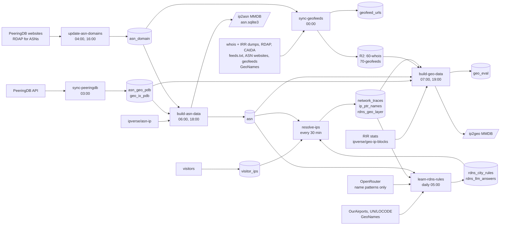

# openipdata pipeline and data sources

As of 2026-11-13.

Seven Hatchet workflows on one VM turn public registry, routing, operator and visitor data into two published MMDBs, ip2asn and ip2geo. Postgres holds the shared tables (one writer each); the private R2 bucket carries the large layer files between workflows.

## At a glance

The collectors write Postgres tables or private R2 files (`resolve-ips` traces the networks visitors come from); only the two builders publish, and `build-geo-data` scores each build before it ships.

## Schedule (UTC)

The morning chain runs PeeringDB → domains → ASN build, so the 06:00 ASN build sees fresh asn-ip, PeeringDB and domain data. Tasks retry twice.

| Time | Workflow | Concurrency limit |
| --- | --- | --- |
| 00:00 | `sync-geofeeds` | `geofeeds` |
| 03:00 | `sync-peeringdb` | `asn-db` |
| 04:00, 16:00 | `update-asn-domains` | `asn-db` |
| 06:00, 18:00 | `build-asn-data` | `asn-db` |
| 07:00, 19:00 | `build-geo-data` (decided: every 4 h, not yet switched) | `geo` |
| every 30 min | `resolve-ips` | `rdns` |
| daily 05:00 | `learn-rdns-rules` | `rdns-rules` |

## Workflows

Each workflow lives in its own folder of `hatchet/` and runs as task chains on the VM; `mmdbbuilder` is a separate binary the worker calls.

| Workflow | Tasks (in order) | Writes | Publishes |
| --- | --- | --- | --- |
| `sync-peeringdb` | `download` → `compute-and-store` | `public.asn_geo_pdb`, `public.geo_ix_pdb` (one transaction; refuses a >10% shrink) | — |
| `update-asn-domains` | `pdb-domains` → `rdap-domains` (≤3,000 ASNs a run) | `public.asn_domain` | — |
| `build-asn-data` | `sync-source` → `ingest` → `build-mmdb` + `export-sqlite` → `publish` | `public.asn` (incl. `seen_at`) | `ip2asn-openipdata.mmdb`, `asn.sqlite3` |
| `sync-geofeeds` | `rdap-lookups` and `probe-domains` beside `discover` → `check-feeds` → `export-rows` | `public.geofeed_urls`; layers `60-whois` and `70-geofeeds` to private R2 | nothing |
| `build-geo-data` | `download` → `build-mmdb` → `evaluate` → `publish` | `public.geo_eval` | `ip2geo-openipdata.mmdb` |
| `resolve-ips` | `pick-networks` → `trace` → `resolve-names` → `locate` | `public.network_traces`, `public.ip_ptr_names`, `public.rdns_geo_layer` (replaced in one transaction; refuses a >10% shrink of the sticky traced rows; candidate and wide rows are only counted) | — |
| `learn-rdns-rules` | `learn` → `propose-codes` | `public.rdns_city_rules` (ranks 1-3 by `learn`, atomic; rank 4 and scoped overrides by `propose-codes`), `public.rdns_llm_answers` | — |

- **`sync-geofeeds`**: finds every geofeed URL (whois, IRR, RDAP, CAIDA, built-in list, ASN websites), fetches and checks each feed, drops rows that fail the ownership check, exports ~6.4M rows (36 MB gz). `discover` also builds the whois geoloc layer.
- **`build-geo-data`**: builds the MMDB from stacked layers (see ip2geo layers), scores it, and publishes only if the scores did not clearly drop.
- **`resolve-ips`**: for IPv4 /24s that visitors came from (`public.visitor_ips`, filled by external websites), traces three hosts with `scamper` (built without privilege separation, next to the worker), names the last routers (PTR), and gives the /24 the city that a rule of `public.generated_rules` finds in a router name. Visitor IPs never leave Postgres and the VM: tasks report counts only.
- **`learn-rdns-rules` / `propose-codes`**: per label, hex runs (6+ characters with a digit, or exactly 7 or 8) become `x` and decimal runs `0` before a name pattern leaves the VM; at most 300 distinct patterns per domain are sent. The model's regex and codes are tested on the real names here: one letters-only capture group, anchored, at least 2 distinct tokens and 20% of the names decoded (small domains: the announced country), every city resolved to one GeoNames place, the learner's domestic gate. An accepted answer is the domain's rank-4 row (`origin = llm`); the learner never touches rank 4 and `-reject` withdraws it. Where a learned rank and rank 4 disagree (other country or over 100 km), the second model is asked, and only when it names the same country within 100 km is the learned token overridden (an `origin = llm` code scoped to its extraction, never over a manual code). `public.rdns_llm_answers` records every question; only `complete` answers count. A domain is asked again when its newest question is incomplete (errors, stops and failed second opinions), when a current learned row has a version its last complete answer did not check, or when its pattern set changed and that answer is 30 days old (`force` overrides). A run makes at most 400 requests, fewer when the key's credit is low, and ends quietly with `stopped: credit_limit` on a key limit, budget or 402 (the domains it reached get the verdict `stopped`). Run only this task with `run-rdns-rules -codes [-domains a,b] [-force]` or the workflow input `{"domains": [...], "force": true}`.

### Tasks

| Workflow | Task | What it does |
| --- | --- | --- |
| `sync-peeringdb` | `download` | fetches PeeringDB `org`, `net`, `fac`, `ix`, `netfac`, `netixlan`, `ixlan`, `ixpfx` fresh into `pdb/*.jsonl` |
| | `compute-and-store` | one row per ASN (country, dominant city, website domain, scope/type, single facility city) and one per exchange peering LAN prefix; replaces both tables in one transaction, refusing a >10% shrink |
| `update-asn-domains` | `pdb-domains` | stores each ASN's PeeringDB website domain (`source = pdb`), replacing RDAP values |
| | `rdap-domains` | looks up to 3,000 due ASNs in RDAP (`source = rdap`), cut to the registered domain, stored one by one |
| `build-asn-data` | `sync-source` | clones or updates ipverse/asn-ip and records its commit and date |
| | `ingest` | parses `as/*/aggregated.json`, upserts changed rows into `public.asn`, stamps `seen_at` |
| | `build-mmdb` | runs `mmdbbuilder asn` → `ip2asn-openipdata-<date>.mmdb` |
| | `export-sqlite` | writes a fresh `asn.sqlite3` (`asn`, `asn_domain`, `asn_geo_pdb`) |
| | `publish` | uploads both to R2 `<date>/`, replaces the MMDB on the GitHub release, pings the health check |
| `sync-geofeeds` | `rdap-lookups` | RDAP for due ARIN, registro.br and LACNIC (Mexico) blocks within a budget; results in `rdap.jsonl` |
| | `probe-domains` | looks for a geofeed at the usual paths of ASN websites; found feeds and their ASNs' prefixes go to `domain-prefixes.csv` |
| | `discover` | reads the whois and IRR dumps, saved RDAP results, domain-found feeds, `feeds.txt` and CAIDA's lists; adds every URL to `public.geofeed_urls`; writes the whois blocks that link feeds; builds `60-whois.csv.gz` from `geoloc:` |
| | `check-feeds` | fetches every due feed, keeps a checked copy of each working one, writes its status to `public.geofeed_urls`, writes the URL lists |
| | `export-rows` | writes the rows of working feeds that pass the ownership check to `70-geofeeds.csv.gz`; uploads both layers to R2 behind their row-drop gates |
| `build-geo-data` | `download` | empties the layers dir; writes `10-rir` to `65-rdns` (except `60-whois`) from the web and Postgres; downloads `60-whois` and `70-geofeeds` from R2 |
| | `build-mmdb` | runs `mmdbbuilder geo` on the layers in name order with the rules table → `ip2geo-openipdata-<date>.mmdb` |
| | `evaluate` | builds the holdout MMDB, scores both with `mmdbbuilder eval` (DB-IP, MaxMind GeoLite2, Atlas probes, holdout), stores a row in `public.geo_eval` |
| | `publish` | applies the 2-point gate, uploads to R2 and the GitHub release, marks the row published, pings the health check |
| `resolve-ips` | `pick-networks` | visitor /24s (seen in the last 30 days, no trace in the last 60), most visitor IPs first, up to 1,000 a run; writes them to a batch file on the VM |
| | `trace` | one `scamper` run (Paris ICMP traceroute) to three hosts per /24: the newest visitor IP, `.1`, a random host; stores the full path, keeps the 2 newest traces per /24 and target kind |
| | `resolve-names` | PTR of every target and of every public answering hop (`hop_ips`); fresh names wait 30 days, not found 7; errors wait 1, 2, then 7 days and preserve stored answers; up to 500 due failures remain eligible beyond the normal 7-day trace window; counts timeouts, SERVFAIL and other failures separately |
| | `locate` | existing rules and carried traced rows first; then learned candidate rules (target name first, then router hops; ranks in order), which give a wide vote and a non-sticky `candidate_rule` traced row that never marks the /24 located; MMDB hop fallback last; one vote per /24; replaces `public.rdns_geo_layer` |
| `learn-rdns-rules` | `learn` | learns up to 3 rules (ranks) per domain from target and hop names, each with at least 3 distinct named IPs on the names better ranks do not decode, at least 2 distinct token values, stop list and GeoNames size limits, domestic country gate; retires learned rows it no longer reproduces; materializes token mappings in Postgres; rejection input withdraws current versions without downloads |
| | `propose-codes` | asks an LLM (OpenRouter; only name patterns, never names or IPs) for the city code of every domain's names: 5+ hosts one domain a request, 1-4 hosts packed by country; checked answers become the rank-4 rule (GeoNames-resolved cities); learned rules it contradicts go to a second model and are overridden only when it agrees within 100 km; skipped without `OPENROUTER_API_KEY` and with `reject_domains`; API trouble never fails it (credit stop, request cap of 400) |

## Data sources

Every external input, grouped by what it feeds. Third-party geo databases are used only as evaluation references, never as data.

| Source | Read by | Used for | Refresh |
| --- | --- | --- | --- |
| ipverse/asn-ip (git) | `build-asn-data` | ASN → announced prefixes | daily (~02:30 upstream) |
| PeeringDB API: org, net, fac, ix, netfac, netixlan, ixlan, ixpfx (`PDB_KEY`) | `sync-peeringdb` | ASN country/city, facility city, exchange LANs, websites | daily |
| RDAP for ASNs | `update-asn-domains` | ASN website domain when PeeringDB has none | 180 d found / 30 d not found |
| Whois dumps: RIPE + APNIC inetnum/inet6num, AFRINIC, LACNIC | `sync-geofeeds` | geofeed links, ownership check; RIPE/APNIC/AFRINIC `geoloc:` | daily, conditional |
| IRR dumps: RIPE, APNIC, ARIN, LACNIC, RADB + 10 mirrors (FTP) | `sync-geofeeds` | more geofeed links | daily, conditional |
| RDAP: ARIN, registro.br, LACNIC (Mexico) | `sync-geofeeds` | geofeed links in space with no public dump | budget per run, 7/30/1-day recheck |
| CAIDA geofeed whois lists | `sync-geofeeds` | ARIN and NIR feeds | last 7 days |
| `feeds.txt` (built-in list: Apple Private Relay, Google Cloud, Charter, …) | `sync-geofeeds` | feeds no whois record points to | with the code |
| ASN websites (from `public.asn_domain`) | `sync-geofeeds` `probe-domains` | feeds at the usual paths | budget per run |
| Operator geofeeds (RFC 8805) | `sync-geofeeds` `check-feeds` | city rows, ~6.4M | backoff 3 d / weekly / monthly |
| GeoNames `cities1000.zip` | `sync-geofeeds` | city name for whois `geoloc:` points | 7-day age gate |
| OurAirports, UNECE UN/LOCODE, GeoNames `cities1000.zip` and `admin1CodesASCII.txt` | `learn-rdns-rules` | city-token dictionaries and GeoNames places with region and coordinates (own caches) | monthly, conditional |
| OpenRouter chat completions (`OPENROUTER_API_KEY`, optional) | `learn-rdns-rules` (`propose-codes`) | city codes of router names, from digit-free name patterns | daily, only domains with new patterns |
| `public.visitor_ips` (external websites insert active users' IPs) | `resolve-ips` | which /24s to trace | every 30 min |
| `scamper` traceroutes, PTR names (system resolver, Cloudflare DoH) | `resolve-ips` | routers near each visitor /24 and their names | per /24 every 60 days; names 30 / 7 days |
| `public.generated_rules` (regex rules written outside this repo) | `resolve-ips` | router name → city | read as is |
| RIR delegated-extended stats (5 RIRs) | `sync-geofeeds`, `build-geo-data` | RDAP block list; country layer | conditional |
| ipverse/geo-ip-blocks (CC0) | `build-geo-data` | registration country (IPv4) | conditional |
| **Evaluation only:** DB-IP Lite city, MaxMind GeoLite2 City (`MAXMIND_LICENSE_KEY`), RIPE Atlas probe archive `meta-latest` | `build-geo-data` `evaluate` | agreement and accuracy scores | monthly / daily |

## Postgres tables, R2 and outputs

Each table has exactly one writer; data between workflows goes through these tables, except the large layer files, which go through the private R2 bucket. VM files are caches only.

| Store | Written by | Read by |
| --- | --- | --- |
| `public.asn` | `build-asn-data` | `build-geo-data` (`seen_at`), `sync-geofeeds` `probe-domains`, `resolve-ips` `locate` (announced prefixes) |
| `public.asn_geo_pdb` | `sync-peeringdb` | `build-asn-data` (`asn.sqlite3`), `build-geo-data` |
| `public.geo_ix_pdb` | `sync-peeringdb` | `build-geo-data` |
| `public.asn_domain` | `update-asn-domains` | `build-asn-data` (`asn.sqlite3`), `sync-geofeeds` `probe-domains` |
| `public.geofeed_urls` | `sync-geofeeds` | `build-geo-data` (holdout sample) |
| `public.geo_eval` | `build-geo-data` | `build-geo-data` (publish gate) |
| `public.visitor_ips` | external websites | `resolve-ips` |
| `public.network_traces` | `resolve-ips` | `resolve-ips`, `learn-rdns-rules` |
| `public.ip_ptr_names` | `resolve-ips` | `resolve-ips`, `learn-rdns-rules` |
| `public.rdns_city_rules` | `learn-rdns-rules` | `resolve-ips` (candidate rules, ranks 1-4: wide votes and non-sticky traced rows) |
| `public.rdns_llm_answers` | `learn-rdns-rules` | `learn-rdns-rules` (what was asked, and the verdict) |
| `public.rdns_geo_layer` | `resolve-ips` | `build-geo-data` (layers `35-rdns-wide`, `65-rdns`) |
| R2 private `internal/layers/60-whois.csv.gz` | `sync-geofeeds` | `build-geo-data` |
| R2 private `internal/layers/70-geofeeds.csv.gz` | `sync-geofeeds` | `build-geo-data` |
| `public.generated_rules` | written outside this repo | `resolve-ips` `locate` (read only) |
| `hostname_reviews` | written outside this repo | nobody yet |

**Published:** `ip2asn-openipdata.mmdb` and `asn.sqlite3` (R2 date folder + rolling GitHub release), `ip2geo-openipdata.mmdb` (R2 + GitHub release, `releases/latest/download/`).

## ip2geo layers

Every layer is a gzipped CSV in the geofeed layout (`prefix,country,region,city,source`). Layers are applied in file-name order and each one overwrites the earlier ones under its prefixes, so operator geofeeds (last) always win.

| # | File | Source | Gives | Guard |
| --- | --- | --- | --- | --- |
| 10 | `10-rir.csv.gz` | RIR delegated stats | country | — (must be first: the guards compare against it) |
| 20 | `20-ipverse.csv.gz` | ipverse/geo-ip-blocks | country | — |
| 30 | `30-pdb.csv.gz` | `public.asn_geo_pdb`: ASN's dominant city (≥30% of its presence) | city | same-country (only refines) |
| 35 | `35-rdns-wide.csv.gz` | `public.rdns_geo_layer`, scope `wide`: the city most traced /24s of an announced prefix (at most /16) got from router names; a trial | city | same-country (only refines) |
| 40 | `40-hosting.csv.gz` | single-city PeeringDB `Content` networks, non-Global scope | city | first-country (only back to the RIR country) |
| 50 | `50-ix.csv.gz` | `public.geo_ix_pdb`: exchange peering LANs | city | — |
| 60 | `60-whois.csv.gz` | whois `geoloc:`, most populous place within 25 km (measured 85.8% within 100 km) | city | within-first |
| 65 | `65-rdns.csv.gz` | `public.rdns_geo_layer`, scope `traced`: a /24 whose traceroute passed a router with a city in its name | city | same-country (only refines) |
| 70 | `70-geofeeds.csv.gz` | operator geofeeds | city | within-first |

- Optional layers (35, 40, 50, 60, 65) are skipped with a warning when missing; a missing or stale R2 layer (60, 70) also skips the health-check ping.
- `35-rdns-wide` sits right after `30-pdb` and `65-rdns` between whois and geofeeds, so every measured layer overwrites the greedy wide rows. `35-rdns-wide` is kept only if `holdout_city_pct` and the Atlas scores do not drop.

## Evaluation and publish gate

`evaluate` scores every build into `public.geo_eval`; `publish` refuses when `atlas_country_pct` or `holdout_country_pct` fell more than 2.0 points against the last published row (`force_publish` overrides).

| Reference | Measures |
| --- | --- |
| Coverage (RIR layer space) | `country_pct`, `city_pct` |
| RIPE Atlas probes (connected, public IPv4) | `atlas_country_pct` |
| Geofeed holdout (frozen 10% of feeds left out of a second build) | `holdout_country_pct`, `holdout_city_pct` |
| DB-IP Lite city | country and city agreement |
| MaxMind GeoLite2 City | country and city agreement; vendor consensus; scored like ours (rating) |

The scores of every build are in `public.geo_eval`.

City accuracy by distance (≤100 km, GeoNames) is planned; today city matches are by name.

## Planned

| Item | Status | Expected effect |
| --- | --- | --- |
| `build-geo-data` every 4 h | decided | results reach users within ~4 h |
| `visitor_city_pct`: share of visitor /24s and /48s in `visitor_ips` (last 30 days) that have a city from a measured layer (`60-whois`, `65-rdns`, `70-geofeeds`) | decided | the 90% target for `resolve-ips`; `city_pct` (whole RIR space) stays as a coverage figure |
| `resolve-ips` phase 1 (visitor IPs from external websites → traces → router names → `65-rdns`, `35-rdns-wide`) | built, not yet deployed | the traced hosts are a trial: keep only the targets that add answers (`unique wins` in the `locate` output); open: where the Atlas part runs (own workflow or inside `resolve-ips`) |
| `35-rdns-wide`: greedy rows on the whole announced prefix, also from hops outside the target's ASN | decided, to test | keep only if `holdout_city_pct` and Atlas scores do not drop; big multi-city ISPs are the risk |
| Atlas routers ≤1 ms from a probe → `atlas_router_locations`; learn and measure rDNS name → city rules | design | ~7,300 located routers per round; ground truth for rules |
| Atlas probe /24s as data (even ids), odd ids for evaluation | proposed | ~6,500 /24s |
| Per-feed geofeed accuracy against Atlas probes | proposed | demote clearly wrong feeds below whois/rDNS |
| Whois city text from measured-good holders | measured, not built | +34k /24s; all text only 52% right |
