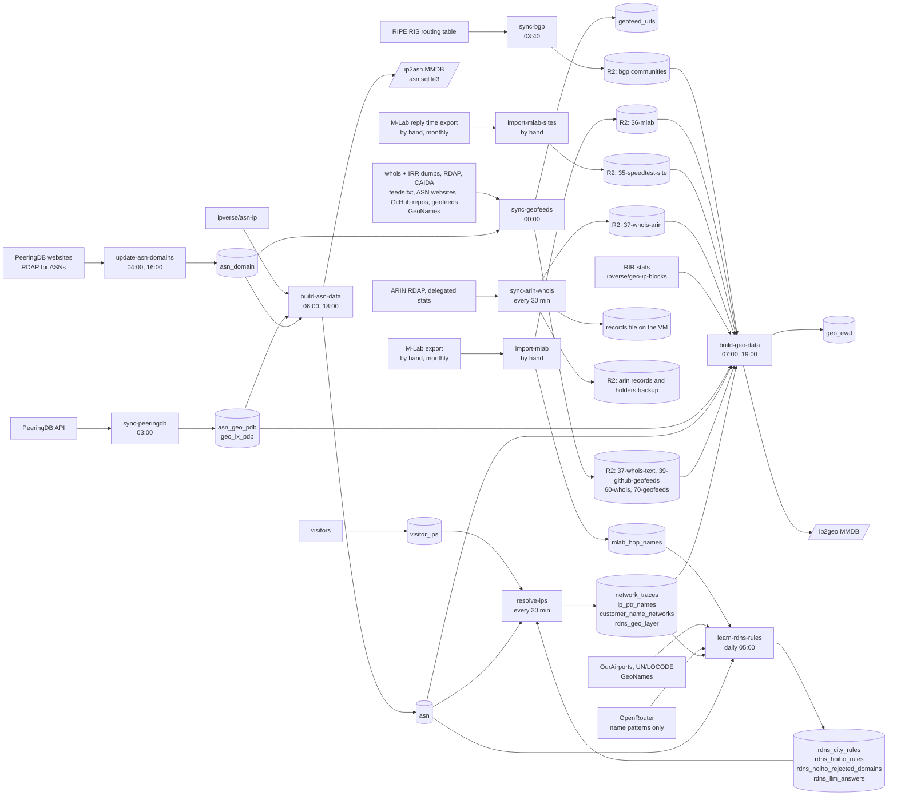

# openipdata pipeline and data sources

As of 2026-11-13.

Eight Hatchet workflows on one VM turn public registry, routing, operator and visitor data into two published MMDBs, ip2asn and ip2geo. Postgres holds the shared tables (one writer each); the private R2 bucket carries the large layer files between workflows.

## At a glance

The collectors write Postgres tables or private R2 files (`resolve-ips` traces the networks visitors come from); only the two builders publish, and `build-geo-data` scores each build before it ships.

## Schedule (UTC)

The morning chain runs PeeringDB → domains → ASN build, so the 06:00 ASN build sees fresh asn-ip, PeeringDB and domain data. Tasks retry twice.

| Time | Workflow | Concurrency limit |
| --- | --- | --- |
| 00:00 | `sync-geofeeds` | `geofeeds` |
| 03:00 | `sync-peeringdb` | `asn-db` |
| 03:40 | `sync-bgp` | `bgp` |
| 04:00, 16:00 | `update-asn-domains` | `asn-db` |
| 06:00, 18:00 | `build-asn-data` | `asn-db` |
| 07:00, 19:00 | `build-geo-data` (decided: every 4 h, not yet switched) | `geo` |
| every 30 min | `resolve-ips` | `rdns` |
| every 30 min | `sync-arin-whois` | `arin` |
| by hand (about monthly) | `import-mlab` | `mlab` |
| by hand (about monthly) | `import-mlab-sites` | `mlab-sites` |
| daily 05:00 | `learn-rdns-rules` | `rdns-rules` |

## Workflows

Each workflow lives in its own folder of `hatchet/` and runs as task chains on the VM; `mmdbbuilder` is a separate binary the worker calls.

| Workflow | Tasks (in order) | Writes | Publishes |
| --- | --- | --- | --- |
| `sync-peeringdb` | `download` → `compute-and-store` | `public.asn_geo_pdb`, `public.geo_ix_pdb` (one transaction; refuses a >10% shrink) | — |
| `update-asn-domains` | `pdb-domains` → `rdap-domains` (≤3,000 ASNs a run) | `public.asn_domain` | — |
| `build-asn-data` | `sync-source` → `ingest` → `build-mmdb` + `export-sqlite` → `publish` | `public.asn` (incl. `seen_at`) | `ip2asn-openipdata.mmdb`, `asn.sqlite3` |
| `sync-geofeeds` | `rdap-lookups`, `probe-domains` and `search-github` beside `discover` → `check-feeds` → `export-rows` | `public.geofeed_urls`; layers `37-whois-text`, `39-github-geofeeds`, `60-whois` and `70-geofeeds` to private R2 | nothing |
| `sync-bgp` | `download` → `extract` → `upload` | the BGP community values of every IPv4 prefix to private R2 (`internal/bgp/communities.csv.gz`) | nothing |
| `sync-arin-whois` | `lookup` → `export` → `upload` | records file on the VM; layer `37-whois-arin` to private R2 (`internal/layers/37-whois-arin.csv.gz`) a daily copy of the records (`internal/arin/records.csv.gz`) and of the holders file (`internal/arin/holders.csv.gz`) | nothing |
| `import-mlab` | `import` → `resolve-names` → `locate` → `upload` | `public.mlab_hop_names`; layer `36-mlab` to private R2 (`internal/layers/36-mlab.csv.gz`) | nothing |
| `import-mlab-sites` | `site-layer` | layer `35-speedtest-site` to private R2 (`internal/layers/35-speedtest-site.csv.gz`) | nothing |
| `build-geo-data` | `download` → `build-mmdb` → `evaluate` → `publish` | `public.geo_eval` | `ip2geo-openipdata.mmdb` |
| `resolve-ips` | `pick-networks` → `trace` → `resolve-names` → `sample-names` → `locate` | `public.network_traces`, `public.ip_ptr_names`, `public.customer_name_networks`, `public.rdns_geo_layer` (replaced in one transaction; refuses a >10% shrink of the sticky traced rows; candidate, wide and named rows are only counted) | — |
| `learn-rdns-rules` | `learn` → `import-hoiho` → `propose-codes` (they share the dictionary cache files) | `public.rdns_city_rules` (ranks 1-3 by `learn`, atomic; rank 4 and scoped overrides by `propose-codes`), `public.rdns_hoiho_rules` and `public.rdns_hoiho_rejected_domains` (`import-hoiho`, `-reject-hoiho`), `public.rdns_llm_answers` | — |

- **`sync-geofeeds`**: finds every geofeed URL (whois, IRR, RDAP, CAIDA, built-in list, ASN websites), fetches and checks each feed, drops rows that fail the ownership check, exports ~6.4M rows (36 MB gz). `discover` also builds the whois geoloc layer.
- **`sync-bgp`**: reads the community values (standard and large) of every IPv4 prefix of /8 to /24 in the RIPE RIS rrc00 table, drops values every route carries (over 5% of prefixes) or fewer than 3 prefixes carry, and uploads 1.16M rows (28 MB gz). No database is read.
- **`sync-arin-whois`**: every 30 minutes. ARIN has no public whois dump, so the workflow asks ARIN's RDAP service (two requests a second, a run lasts at most 24 minutes and goes on from a saved position) about one address of each IPv4 /24 where our MMDB has a country but a weak city or none, inside ARIN's address space. It keeps the network record (range, registrant city, state, country; never wider than a /16; wider ones up to a /8 and the class of the holder, `edu`, `gov`, `mil` or `other`, go to a second file for a later guess) in a file on the VM (a copy goes to private R2 once a day; no database table) and writes layer `37-whois-arin` from the records of at most a /20, and of at most a /16 when the holder is a school, university or local government (class from the registrant's name by a fixed rule, never stored; commercial names, state governments and statewide bodies are `other`; measured: edu 78% right, local government 11 of 11, everyone else 26%), whose city GeoNames places in the record's own state. A walk over all /24s takes about five weeks; the next one starts 180 days after the last began. Measured on RIPE Atlas: +197 right, -37 lost probes, 61% of 531 rows right.
- **`import-mlab`**: no cron. M-Lab publishes (CC0) a traceroute from its speed-test server to every client; the owner exports the last 3 router hops before each client /24 from BigQuery by hand (see the README, "M-Lab export") and copies the CSV into `/var/lib/openipdata/mlab/inbox/`. The workflow names the hop IPs (PTR, the `resolve-names` resolver), decodes the names with the production rules, falls back on the hop IP's own city in our published MMDB (strong sources only) and gives each client /24 the city its hops vote for (traces as weights, a tie gives none): layer `36-mlab`. Measured on RIPE Atlas: about +238 right probes (+1.7 points), precision about 41%.
- **`import-mlab-sites`**: no cron; a workflow of its own, so that a new reply time export does not run the tasks of `import-mlab` again. Its task `site-layer` makes the layer `35-speedtest-site` from a second export (the lowest reply time between M-Lab's speed test servers and each client /24, copied into `/var/lib/openipdata/mlab/sites-inbox/`, see the README, "Reply-time export"): a client /24 whose lowest reply time to a server is at most 5 ms gets the city of that server when GeoNames places it in the server's country. Measured on RIPE Atlas (rebuild of 2026-11-19, 21-day export): 401,813 rows, +63 right and -13 lost probes, the layer's own city right for 64% of 372 probes.
- **`build-geo-data`**: builds the MMDB from stacked layers (see ip2geo layers), scores it, and publishes only if the scores did not clearly drop.
- **`resolve-ips`**: for IPv4 /24s that visitors came from (`public.visitor_ips`, filled by external websites), traces three hosts with `scamper` (built without privilege separation, next to the worker), names the last routers (PTR), and gives the /24 the city that a rule of `public.generated_rules` finds in a router name. Visitor IPs never leave Postgres and the VM: tasks report counts only.
- **`learn-rdns-rules` / `propose-codes`**: per label, hex runs (6+ characters with a digit, or exactly 7 or 8) become `x` and decimal runs `0` before a name pattern leaves the VM; at most 300 distinct patterns per domain are sent. The model's regex and codes are tested on the real names here: one letters-only capture group, anchored, at least 2 distinct tokens and 20% of the names decoded (small domains: the announced country), every city resolved to one GeoNames place, the learner's domestic gate. An accepted answer is the domain's rank-4 row (`origin = llm`); the learner never touches rank 4 and `-reject` withdraws it. Where a learned rank and rank 4 disagree (other country or over 100 km), the second model is asked, and only when it names the same country within 100 km is the learned token overridden (an `origin = llm` code scoped to its extraction, never over a manual code). `public.rdns_llm_answers` records every question; only `complete` answers count. A domain is asked again when its newest question is incomplete (errors, stops and failed second opinions), when a current learned row has a version its last complete answer did not check, or when its pattern set changed and that answer is 30 days old (`force` overrides). A run makes at most 400 requests, fewer when the key's credit is low, and ends quietly with `stopped: credit_limit` on a key limit, budget or 402 (the domains it reached get the verdict `stopped`). Run only this task with `run-rdns-rules -codes [-domains a,b] [-force]` or the workflow input `{"domains": [...], "force": true}`.

### Tasks

| Workflow | Task | What it does |
| --- | --- | --- |
| `sync-peeringdb` | `download` | fetches PeeringDB `org`, `net`, `fac`, `ix`, `netfac`, `netixlan`, `ixlan`, `ixpfx` fresh into `pdb/*.jsonl` |
| | `compute-and-store` | one row per ASN (country, dominant city, website domain, scope/type, single facility city) and one per exchange peering LAN prefix; replaces both tables in one transaction, refusing a >10% shrink |
| `update-asn-domains` | `pdb-domains` | stores each ASN's PeeringDB website domain (`source = pdb`), replacing RDAP values |
| | `rdap-domains` | looks up to 3,000 due ASNs in RDAP (`source = rdap`), cut to the registered domain, stored one by one |
| `build-asn-data` | `sync-source` | clones or updates ipverse/asn-ip and records its commit and date |
| | `ingest` | parses `as/*/aggregated.json`, upserts changed rows into `public.asn`, stamps `seen_at` |
| | `build-mmdb` | runs `mmdbbuilder asn` → `ip2asn-openipdata-<date>.mmdb` |
| | `export-sqlite` | writes a fresh `asn.sqlite3` (`asn`, `asn_domain`, `asn_geo_pdb`) |
| | `publish` | uploads both to R2 `<date>/`, replaces the MMDB on the GitHub release, pings the health check |
| `sync-geofeeds` | `rdap-lookups` | RDAP for due ARIN, registro.br and LACNIC (Mexico) blocks within a budget; results in `rdap.jsonl` |
| | `probe-domains` | looks for a geofeed at the usual paths of ASN websites; found feeds and their ASNs' prefixes go to `domain-prefixes.csv` |
| | `search-github` | searches public GitHub repositories named like `geofeed`, lists the new or changed ones and keeps the files that read as a geofeed in `github.json` (`GITHUB_TOKEN` optional: 40 repositories a run without it, 1000 with it; never-tried repositories first, then failed ones, then the changed ones, oldest listed first; a 45-minute soft time budget; a rejected token (401) is dropped for the run); a rate limit (429, or 403 with `Retry-After` or `X-RateLimit-Remaining: 0`) ends the run with the progress saved, any other 403 or 451 on one repository is just an answer |
| | `discover` | reads the whois and IRR dumps, saved RDAP results, domain-found feeds, GitHub-found feeds (source `github`), `feeds.txt` and CAIDA's lists; adds every URL to `public.geofeed_urls`; writes the whois blocks that link feeds; builds `60-whois.csv.gz` from `geoloc:` and `37-whois-text.csv.gz` from the `descr:` and `netname:` text of RIPE and AFRINIC inetnums and the `city:` line of LACNIC inetnums (GeoNames is loaded first) |
| | `check-feeds` | fetches every due feed, keeps a checked copy of each working one, writes its status to `public.geofeed_urls`, writes the URL lists |
| | `export-rows` | writes the rows of working feeds that pass the ownership check to `70-geofeeds.csv.gz`; uploads both layers to R2 behind their row-drop gates |
| `sync-bgp` | `download` | fetches the newest RIPE RIS rrc00 table (`latest-bview.gz`, ~430 MB) into its own dir, not again within 6 hours |
| | `extract` | streams the MRT file in two passes (value counts, then rows) into `bgp-communities.csv.gz` |
| | `upload` | puts it at the fixed R2 key with the sha256 in the metadata (unchanged: not sent, upload time renewed), pings `HC_PING_BGP` |
| `sync-arin-whois` | `lookup` | stats file of ARIN (24 h gate) and the gap list (`mmdbbuilder gaps` on our MMDB copy, made again only when its ETag changed); walks the /24 indexes from the saved position (`progress.json`; a lost records file is restored from R2 first, and with R2 down the task is skipped), 200 targets (gap, inside ARIN, public) at a time, one RDAP lookup each at two a second; appends the holder rows (`holders.csv`, synced; a later answer of a range whose newest row is edu or gov is written too, so it switches that row off; when the restore of the file from R2 failed, nothing is appended that run), then the records to the journal (synced), then moves the position; no /24 is skipped inside a wide record; an answer 429 pauses all workers; stops on the soft budget (24 min from the task start), 5 pauses in a row, 10 failed lookups in a row or a batch with many failed lookups (not stored) |
| | `export` | compacts the records file (base + journal, newest record of a range wins, records older than 300 days dropped), compacts `holders.csv` too, then takes the records with a city and at most a /20 plus the `edu` and `gov` holder rows of at most a /16, placed by GeoNames in the record's own state (US admin1 = state, Canada by a code table); writes `37-whois-arin.csv.gz` |
| | `upload` | the layer to `internal/layers/37-whois-arin.csv.gz` (identical object not sent again); once a day the records file to `internal/arin/records.csv.gz` (refused when it has less than half the records of the last copy) and `holders.csv` gzipped to `internal/arin/holders.csv.gz` (also refused below half the rows of the last copy; the two copies are separate, so after a wipe the restored position can be newer than the restored holders) |
| `import-mlab` | `import` | streams the CSV of the inbox (plain or gz; untrusted: columns by header, public IPv4 only, `from_end` 0 to 2) into `pairs.csv.gz`, one row per client /24 and hop, replacing the last one |
| | `resolve-names` | PTR of the distinct hop IPs into `public.mlab_hop_names` (answers younger than 60 days are skipped; stored 2000 at a time; a 3-hour budget ends it cleanly with `stopped: time`) |
| | `locate` | R: hops whose name a rule decodes to a city vote (weight = traces); no winner: M: hops with a city in a strong-source record of our MMDB vote; only the client /24's country counts; writes `36-mlab.csv.gz` |
| | `upload` | puts it at the fixed R2 key with the sha256 in the metadata (unchanged: not sent); no health-check ping |
| `import-mlab-sites` | `site-layer` | streams the CSV of the sites inbox (plain or gz; untrusted: columns by header, quoted fields, public IPv4 client /24s), keeps the smallest reply time of each client /24, keeps those at most 5 ms whose city GeoNames places in the server's country (own copy of `cities1000.zip`), writes `35-speedtest-site.csv.gz` and puts it at the fixed R2 key (`skipped: no file` when the inbox has none; too few rows keep the old file) |
| `build-geo-data` | `download` | empties the layers dir; writes `10-rir` to `67-rdns-names` (except `60-whois`) from the web and Postgres; downloads `60-whois` and `70-geofeeds` from R2, then writes `38-asn-geofeed` and `68-cloud-regions` (from Amazon's region file) from the geofeed layer and `25-bgp` from the geofeed layer and the R2 communities file; downloads `35-speedtest-site`, `36-mlab`, `37-whois-arin`, `37-whois-text` and `39-github-geofeeds` from R2 as they are |
| | `build-mmdb` | runs `mmdbbuilder geo` on the layers in name order with the rules table → `ip2geo-openipdata-<date>.mmdb` |
| | `evaluate` | builds the holdout MMDB, scores both with `mmdbbuilder eval` (DB-IP, MaxMind GeoLite2, Atlas probes, GeoNames to place our cities; holdout for ours only), stores a row in `public.geo_eval`, then stamps the scores into the MMDB's metadata (`description.openipdata`; a failure never blocks publish) |
| | `publish` | applies the 2-point gate, uploads to R2 and the GitHub release, marks the row published, pings the health check |
| `resolve-ips` | `pick-networks` | visitor /24s (seen in the last 30 days, no trace in the last 60), most visitor IPs first, up to 1,000 a run; writes them to a batch file on the VM |
| | `trace` | one `scamper` run (Paris ICMP traceroute) to three hosts per /24: the newest visitor IP, `.1`, a random host; stores the full path, keeps the 2 newest traces per /24 and target kind |
| | `resolve-names` | PTR of every target and of every public answering hop (`hop_ips`); fresh names wait 30 days, not found 7; errors wait 1, 2, then 7 days and preserve stored answers; up to 500 due failures remain eligible beyond the normal 7-day trace window; counts timeouts, SERVFAIL and other failures separately |
| | `sample-names` | the gap = /24s with a country and no city in the published MMDB (`mmdbbuilder gaps`, made again only when its ETag changes); a fixed shuffled walk over all 2^24 /24s (cursor in `sample-state.json`) takes up to 2000 gap /24s per run, `.1` plus 2 random hosts each, PTR with the `resolve-names` resolver (not stored in `ip_ptr_names`); /24s with a name go to `public.customer_name_networks`; at most one run per 25 minutes, one cycle per 180 days; DNS problems never fail it, no MMDB = `skipped` |
| | `locate` | existing rules and carried traced rows first; then candidate rules (target name first, then router hops; the LLM rule, then the Hoiho rules, then the learned ranks in order), which give a wide vote and a non-sticky `candidate_rule` traced row that never marks the /24 located; MMDB hop fallback last; one vote per /24; a gap /24 whose sampled customer names decode to one city (majority; a tie or another country gives none) gets a volatile row of scope `named`; replaces `public.rdns_geo_layer`; skipped when nothing changed for 24 hours, or when only other inputs than the rules changed and the last rebuild is under 6 hours old (a rule change rebuilds at once) |
| `learn-rdns-rules` | `learn` | learns up to 3 rules (ranks) per domain from target and hop names, each with at least 3 distinct named IPs on the names better ranks do not decode, at least 2 distinct token values, stop list and GeoNames size limits, domestic country gate; retires learned rows it no longer reproduces; materializes token mappings in Postgres; rejection input withdraws current versions without downloads |
| | `propose-codes` | asks an LLM (OpenRouter; only name patterns, never names or IPs) for the city code of every domain's names: 5+ hosts one domain a request, 1-4 hosts packed by country; checked answers become the rank-4 rule (GeoNames-resolved cities); learned rules it contradicts go to a second model and are overridden only when it agrees within 100 km; skipped without `OPENROUTER_API_KEY` and with `reject_domains`; API trouble never fails it (credit stop, request cap of 400) |
| | `import-hoiho` | downloads CAIDA's Hoiho router-name rules (ITDK 2024-08, 30-day check, at most 32 MB), keeps the regexes whose capture plan is usable (one location type, optional `cc` and `st`) and matches their codes to GeoNames places (50 km around the published coordinates, else the most populous place within 30 km; CLLI codes without a place guessed from four abbreviating letters and a state or province); replaces `public.rdns_hoiho_rules` in one transaction only when the rows changed, refuses fewer than 500 rows and a file with fewer than 300 records or more than 500,000 keys (a regex with more than 50,000 keys is skipped); a file or GeoNames problem only skips it, and only a bad file is dropped from the cache; `run-rdns-rules -reject-hoiho` / `-accept-hoiho`, or the workflow inputs `reject_hoiho_domains` / `accept_hoiho_domains` (a run that only switches), switch a suffix and every name under it off or on (list in `public.rdns_hoiho_rejected_domains`, kept across imports); `-reject` does not touch these rules |

## Data sources

Every external input, grouped by what it feeds. Third-party geo databases are used only as evaluation references, never as data.

| Source | Read by | Used for | Refresh |
| --- | --- | --- | --- |
| ipverse/asn-ip (git) | `build-asn-data` | ASN → announced prefixes | daily (~02:30 upstream) |
| PeeringDB API: org, net, fac, ix, netfac, netixlan, ixlan, ixpfx (`PDB_KEY`) | `sync-peeringdb` | ASN country/city, facility city, exchange LANs, websites | daily |
| RDAP for ASNs | `update-asn-domains` | ASN website domain when PeeringDB has none | 180 d found / 30 d not found |
| Whois dumps: RIPE + APNIC inetnum/inet6num, AFRINIC, LACNIC | `sync-geofeeds` | geofeed links, ownership check; RIPE/APNIC/AFRINIC `geoloc:` | daily, conditional |
| IRR dumps: RIPE, APNIC, ARIN, LACNIC, RADB + 10 mirrors (FTP) | `sync-geofeeds` | more geofeed links | daily, conditional |
| RDAP: ARIN, registro.br, LACNIC (Mexico) | `sync-geofeeds` | geofeed links in space with no public dump | budget per run, 7/30/1-day recheck |
| CAIDA geofeed whois lists | `sync-geofeeds` | ARIN and NIR feeds | last 7 days |
| `feeds.txt` (built-in list: Apple Private Relay, Google Cloud, Charter, …) | `sync-geofeeds` | feeds no whois record points to | with the code |
| ASN websites (from `public.asn_domain`) | `sync-geofeeds` `probe-domains` | feeds at the usual paths | budget per run |
| GitHub repositories named like `geofeed` (GitHub API) | `sync-geofeeds` `search-github` | geofeed files no whois record links | budget per run (40 repositories, 1000 with a token) |
| Operator geofeeds (RFC 8805) | `sync-geofeeds` `check-feeds` | city rows, ~6.4M | backoff 3 d / weekly / monthly |
| GeoNames `cities1000.zip` | `sync-geofeeds` | city name for whois `geoloc:` points; place names for the text of RIPE and AFRINIC inetnums | 7-day age gate |
| OurAirports, UNECE UN/LOCODE, GeoNames `cities1000.zip` and `admin1CodesASCII.txt` | `learn-rdns-rules` | city-token dictionaries and GeoNames places with region and coordinates (own caches) | monthly, conditional |
| CAIDA ITDK 2024-08 Hoiho router-name rules (`midar-iff.geo-re.jsonl`, 2 MB) | `learn-rdns-rules` (`import-hoiho`) | regexes and codes that decode router names to places | 30-day check |
| OpenRouter chat completions (`OPENROUTER_API_KEY`, optional) | `learn-rdns-rules` (`propose-codes`) | city codes of router names, from digit-free name patterns | daily, only domains with new patterns |
| `public.visitor_ips` (external websites insert active users' IPs) | `resolve-ips` | which /24s to trace | every 30 min |
| `scamper` traceroutes, PTR names (local resolver or system resolver, Cloudflare DoH) | `resolve-ips` | routers near each visitor /24 and their names | per /24 every 60 days; names 30 / 7 days |
| `public.generated_rules` (regex rules written outside this repo) | `resolve-ips` | router name → city | read as is |
| ARIN RDAP `https://rdap.arin.net/registry/ip/<address>` (two requests a second) and ARIN's `delegated-arin-extended-latest` stats | `sync-arin-whois` | the network record of one address per gap /24 (range, registrant city, state, country) | every 30 minutes, up to 24 minutes a run; stats at most every 24 hours |
| RIPE RIS rrc00 routing table `latest-bview.gz` (public MRT dump) | `sync-bgp` | BGP community values per IPv4 prefix | daily, conditional, not within 6 hours |
| RIR delegated-extended stats (5 RIRs) | `sync-geofeeds`, `build-geo-data` | RDAP block list; country layer | conditional |
| ipverse/geo-ip-blocks (CC0) | `build-geo-data` | registration country (IPv4) | conditional |
| **Evaluation only:** DB-IP Lite city, MaxMind GeoLite2 City (`MAXMIND_LICENSE_KEY`), RIPE Atlas probe archive `meta-latest`, GeoNames `cities1000` (CC BY 4.0, 7-day gate) | `build-geo-data` `evaluate` | agreement and accuracy scores | monthly / daily |

## Postgres tables, R2 and outputs

Each table has exactly one writer; data between workflows goes through these tables, except the large layer files, which go through the private R2 bucket. VM files are caches only.

| Store | Written by | Read by |
| --- | --- | --- |
| `public.asn` | `build-asn-data` | `build-geo-data` (`seen_at`; only the `prefixes` object of `json`, the whole json if one value is damaged), `sync-geofeeds` `probe-domains`, `resolve-ips` `locate` (announced prefixes) |
| `public.asn_geo_pdb` | `sync-peeringdb` | `build-asn-data` (`asn.sqlite3`), `build-geo-data` |
| `public.geo_ix_pdb` | `sync-peeringdb` | `build-geo-data` |
| `public.asn_domain` | `update-asn-domains` | `build-asn-data` (`asn.sqlite3`), `sync-geofeeds` `probe-domains` |
| `public.geofeed_urls` | `sync-geofeeds` | `build-geo-data` (holdout sample) |
| `public.geo_eval` | `build-geo-data` | `build-geo-data` (publish gate) |
| `public.visitor_ips` | external websites | `resolve-ips` |
| `public.network_traces` | `resolve-ips` | `resolve-ips`, `learn-rdns-rules` |
| `public.ip_ptr_names` | `resolve-ips` | `resolve-ips`, `learn-rdns-rules` |
| `public.rdns_city_rules` | `learn-rdns-rules` | `resolve-ips` (candidate rules, ranks 1-4: wide votes and non-sticky traced rows) |
| `public.rdns_hoiho_rules`, `public.rdns_hoiho_rejected_domains` | `learn-rdns-rules` | `resolve-ips`, `import-mlab` (router-name rules tried after the LLM rules and before the learned ones, as candidate rules) |
| `public.rdns_llm_answers` | `learn-rdns-rules` | `learn-rdns-rules` (what was asked, and the verdict) |
| `public.customer_name_networks` | `resolve-ips` | `learn-rdns-rules` (the names of the sampled hosts, capped per domain), `resolve-ips` (`locate`) |
| `public.mlab_hop_names` | `import-mlab` | `import-mlab` (`locate`), `learn-rdns-rules` (the ok names as router names, capped per domain) |
| `public.rdns_geo_layer` | `resolve-ips` | `build-geo-data` (layers `35-rdns-wide`, `65-rdns`, `67-rdns-names`) |
| R2 private `internal/layers/37-whois-text.csv.gz` | `sync-geofeeds` | `build-geo-data` |
| R2 private `internal/layers/39-github-geofeeds.csv.gz` | `sync-geofeeds` | `build-geo-data` |
| R2 private `internal/layers/60-whois.csv.gz` | `sync-geofeeds` | `build-geo-data` |
| R2 private `internal/layers/70-geofeeds.csv.gz` | `sync-geofeeds` | `build-geo-data` |
| R2 private `internal/bgp/communities.csv.gz` | `sync-bgp` | `build-geo-data` (layer `25-bgp`) |
| R2 private `internal/layers/36-mlab.csv.gz` | `import-mlab` | `build-geo-data` (layer `36-mlab`) |
| R2 private `internal/layers/35-speedtest-site.csv.gz` | `import-mlab-sites` | `build-geo-data` (layer `35-speedtest-site`) |
| R2 private `internal/layers/37-whois-arin.csv.gz` | `sync-arin-whois` | `build-geo-data` (layer `37-whois-arin`) |
| R2 private `internal/arin/records.csv.gz` | `sync-arin-whois` (`upload`, once a day) | `sync-arin-whois` (`lookup`, restores the records file when it is lost); no other workflow |
| R2 private `internal/arin/holders.csv.gz` | `sync-arin-whois` (`upload`, once a day) | `sync-arin-whois` (`lookup`, restores the holders file when it is missing); no other workflow |
| `public.generated_rules` | written outside this repo | `resolve-ips` `locate` (read only) |
| `hostname_reviews` | written outside this repo | nobody yet |

**Published:** `ip2asn-openipdata.mmdb` and `asn.sqlite3` (R2 date folder + rolling GitHub release), `ip2geo-openipdata.mmdb` (R2 + GitHub release, `releases/latest/download/`).

## ip2geo layers

Every layer is a gzipped CSV in the geofeed layout (`prefix,country,region,city,source`). Layers are applied in file-name order and each one overwrites the earlier ones under its prefixes, so operator geofeeds (last) always win.

| # | File | Source | Gives | Guard |
| --- | --- | --- | --- | --- |
| 10 | `10-rir.csv.gz` | RIR delegated stats | country | — (must be first: the guards compare against it) |
| 20 | `20-ipverse.csv.gz` | ipverse/geo-ip-blocks | country | — |
| 25 | `25-bgp.csv.gz` | BGP community values (`sync-bgp`, R2) learned on prefixes whose city a geofeed gives (≥3 known prefixes, ≥80% one city, ≥90% one country), given to prefixes whose rules all agree, owned parts only; sits below `30-pdb`, so it only shows where nothing else gives a city; measured 52.6% right within 50 km on Atlas gap probes | city | same-country (only refines) |
| 30 | `30-pdb.csv.gz` | `public.asn_geo_pdb`: ASN's dominant city (≥30% of its presence) | city | same-country (only refines) |
| 35 | `35-rdns-wide.csv.gz` | `public.rdns_geo_layer`, scope `wide`: the city most traced /24s of an announced prefix (at most /16) got from router names; a trial | city | same-country (only refines) |
| 35 | `35-speedtest-site.csv.gz` | M-Lab speed tests (`import-mlab-sites`, task `site-layer`, R2): a client /24 whose lowest reply time to a speed test server is at most 5 ms gets that server's city when GeoNames places it in the server's country; made by hand from a monthly export; sits below `36-mlab` and everything after it; measured +63 right and -13 lost Atlas probes (right for 64% of the probes it answers) | city | same-country (only refines) |
| 36 | `36-mlab.csv.gz` | M-Lab traceroutes (`import-mlab`, R2): the city of the last router hops before each client /24 (a rule-decoded router name first, else the hop IP's own city in our MMDB from `70-geofeeds`, `60-whois`, `40-hosting`, `50-ix` or `38-asn-geofeed`), the largest trace weight wins, a tie gives none; made by hand from a monthly export; sits below `38-asn-geofeed` and everything after it; measured about +238 right Atlas probes at 41% precision | city | same-country (only refines) |
| 37 | `37-whois-arin.csv.gz` | the registrant city of ARIN RDAP records of at most a /20 (and of at most a /16 for schools, universities and governments) for the gap /24s (`sync-arin-whois`, R2), only a city that GeoNames places in the record's own state; records wider than a /16 (head offices) are not in the layer; measured on RIPE Atlas: +197 right, -37 lost probes, the layer's city right for 61% of 531 rows | city | same-country (only refines) |
| 37 | `37-whois-text.csv.gz` | RIPE and AFRINIC inetnum `descr:` and `netname:` text, and the `city:` line of LACNIC inetnums, that names a GeoNames place of the object's country (longest word group, then the most populous place; an ignore list, short words and records broader than a /16 are left out; `sync-geofeeds`, R2); measured on RIPE Atlas: +384 right, -81 lost probes (net +303) above the weak layers, the layer's city right for 68% of the 995 probes it answers; the LACNIC rows: +75 right, -33 lost, right for 60% of 324 probes | city | same-country (only refines) |
| 38 | `38-asn-geofeed.csv.gz` | the ASN's own geofeed rows (`70-geofeeds` attributed by announced prefix, MOAS prefixes ignored): an ASN whose feed rows cover ≥50% of its announced addresses (per address family) and put ≥80% of their addresses (country-only rows count in the total) in one city, from ≥2 rows, gives that city to all its announced prefixes | city | same-country (only refines) |
| 39 | `39-github-geofeeds.csv.gz` | rows of geofeed files in public GitHub repositories named like `geofeed` that no whois record links (`sync-geofeeds` `search-github`, R2); a feed already read under another URL (a feed just read in the same repository, or the same rows) is left out, and so are a row with no city (`no_city`: a country-only row would erase a lower layer's city) and one broader than a /16 or /32 (`too_broad`); uploaded with no first-upload minimum and no drop limit; measured on RIPE Atlas: +32 right, -7 lost probes where our city was weak, a guess or missing, right for 61% of 88 probes; against `70-geofeeds` cities -4 and +0, so it sits below them | city | same-country (only refines) |
| 40 | `40-hosting.csv.gz` | single-city PeeringDB `Content` networks, non-Global scope | city | first-country (only back to the RIR country) |
| 50 | `50-ix.csv.gz` | `public.geo_ix_pdb`: exchange peering LANs | city | — |
| 60 | `60-whois.csv.gz` | whois `geoloc:`, most populous place within 25 km (measured 85.8% within 100 km) | city | within-first |
| 65 | `65-rdns.csv.gz` | `public.rdns_geo_layer`, scope `traced`: a /24 whose traceroute passed a router with a city in its name | city | same-country (only refines) |
| 67 | `67-rdns-names.csv.gz` | `public.rdns_geo_layer`, scope `named`: a gap /24 whose sampled customer PTR names decode to one city in the row's country | city | same-country (only refines) |
| 68 | `68-cloud-regions.csv.gz` | Amazon's region file (`ip-ranges.json`, IPv4 only): the main geofeed city of each region or zone (label = `network_border_group`, else `region`; learned from `70-geofeeds`: ≥4,096 addresses with a city, main city ≥80%, so a small zone gets no row) for all its ranges; the most specific prefix decides the label, `GLOBAL` gets none, neighbouring prefixes are not merged; measured by a script on the build of 2026-11-18: 16.5M addresses get a place, the country is corrected for 14.1M. Also Oracle Cloud's region file (`public_ip_ranges.json`): every range of a region gets the city of a fixed table of 45 regions (Oracle has no geofeed to learn from; a region outside the table gets no row); measured on the build of 2026-11-19: +113 right RIPE Atlas probes, 1.86M addresses get a place, the country is corrected for 2.97M | city and country | within-first |
| 70 | `70-geofeeds.csv.gz` | operator geofeeds | city | within-first |

- `38-asn-geofeed` is computed in `download` from the geofeed layer and `public.asn` (read once, saved as `geo/asn-prefixes.csv.gz`); the holdout build recomputes it from the kept feeds, so held-out feeds do not leak into it.
- `80-asn-main` is a guess, not a layer file: `mmdbbuilder geo -asn-main geo/asn-prefixes.csv.gz` applies it after all layers (it needs their merged result; IPv4 only). For each ASN and country, when one city has at least 90% of the addresses that have a city (and there are at least 256), the ASN's addresses there with no city get it (with GeoNames only cities it places count; others are ignored for the counts) (`city_source` `80-asn-main`). It only fills. The holdout build recomputes it. `download` removes `asn-prefixes.csv.gz` before it reads `public.asn`, so a stale file is never used; without it `build-mmdb` reports `asn_main: skipped: no ASN prefixes` (`skipped: ASN prefixes unreadable` for a bad file; the build goes on). The guessed cities count in `city_pct`, `atlas_city_*` and the holdout city score like any other (`layer_80_asn_main_*` show the fill alone); the gate checks only country scores. `gaps` and `lookup -in` treat these cities as no city.
- `25-bgp` is computed in `download` from the geofeed layer and the communities file of `sync-bgp` (saved in `geo/downloads/`, not a layer file); the holdout build recomputes it from the kept feeds. A missing, old (over 3 days) or unreadable object only skips it; it never skips the health-check ping.
- `35-speedtest-site` is put in as it is from the R2 object (saved in `geo/downloads/` with its ETag). A missing object, one older than 45 days (the export is made by hand about monthly; the age counts from the last new export, the same file uploaded again keeps its date) or any fetch error only skips it with a warning; it never skips the health-check ping. The holdout build passes it as it is: it is not learned from the geofeed rows and reads no MMDB. `gaps` counts a /24 whose city comes from it as no city, so `sample-names` keeps sampling customer names there.
- `36-mlab` is put in as it is from the R2 object (saved in `geo/downloads/` with its ETag). A missing object, one older than 45 days (the export is made by hand about monthly) or any fetch error only skips it with a warning; it never skips the health-check ping. The holdout build passes it as it is: it does not learn from the geofeed rows directly, but its MMDB-hop part reads the published MMDB (which holds geofeed cities), like the MMDB votes of `35-rdns-wide`. `gaps` counts a /24 whose city comes from `25-bgp`, `35-speedtest-site` or `36-mlab` (like the `80-asn-main` guess) as no city, so `sample-names` keeps sampling customer names there.
- `37-whois-arin` is put in as it is from the R2 object (saved in `geo/downloads/` with its ETag). One older than 14 days, a missing object or any fetch error skips it with a warning; it never skips the health-check ping. The holdout build passes it as it is: it is not learned from the geofeed rows. `gaps` counts a /24 whose city comes from this layer as no city, so `sync-arin-whois` keeps these /24s in its walk and `sample-names` keeps sampling customer names there.
- `37-whois-text` is put in as it is from the R2 object (saved in `geo/downloads/` with its ETag). One older than 14 days, a missing object or any fetch error skips it with a warning; a missing object or a fetch error never skips the health-check ping. An existing object older than 3 days is still used up to 14 days but skips the ping (`sync-geofeeds` renews it every night). The holdout build passes it as it is: it is not learned from the geofeed rows.
- `39-github-geofeeds` is put in as it is from the R2 object (saved in `geo/downloads/` with its ETag). One older than 14 days, a missing object or any fetch error skips it with a warning and never skips the health-check ping. The holdout build leaves it out (a copy of a held-out feed that differs by a row or by row order would pass the duplicate rules and bring the held-out cities back). `export-rows` writes only rows with a city and none broader than a /16 or a /32, has no 10% drop gate for it (three feeds carry most rows), and leaves out every feed that is read under another URL; when its local file is removed the R2 object stays and is used until it is 14 days old.
- `68-cloud-regions` is computed in `download` from the geofeed layer and Amazon's region file (saved as `geo/downloads/aws-ip-ranges.json`, capped at 32 MB; a failed fetch uses the saved copy while it was confirmed less than 14 days ago) and from Oracle's region file (`geo/downloads/oracle-ip-ranges.json`, the same rules) with its table of region cities; the holdout build recomputes Amazon's rows from the kept feeds and the saved file and takes Oracle's as they are. An operator that gives no rows is only left out (`cloud_regions_left_out`). A row broader than one `10-rir` prefix is dropped by the builder (`-within-first`) and shows in its skipped count for the layer. With no row from either operator the layer is skipped with a warning; it never skips the health-check ping.
- Optional layers (25, 35, 36, 37, 38, 39, 40, 50, 60, 65, 67, 68) are skipped with a warning when missing; a missing or stale R2 layer (60, 70) also skips the health-check ping.
- `35-rdns-wide` sits right after `30-pdb` and `65-rdns` between whois and geofeeds, so every measured layer overwrites the greedy wide rows. `35-rdns-wide` is kept only if `holdout_city_pct` and the Atlas scores do not drop.

## Evaluation and publish gate

`evaluate` scores every build into `public.geo_eval`; `publish` refuses when `atlas_country_pct` or `holdout_country_pct` fell more than 2.0 points against the last published row (`force_publish` overrides).

| Reference | Measures |
| --- | --- |
| Coverage (RIR layer space) | `country_pct`, `city_pct` |
| RIPE Atlas probes (connected, public IPv4) | `atlas_country_pct`, `atlas_city_pct` (ours placed with GeoNames, within 50 km; `atlas_city_unresolved`) |
| Geofeed holdout (frozen 10% of feeds left out of a second build) | `holdout_country_pct`, `holdout_city_pct`, and by `city_source` `layer_<src>_holdout_city_answered` / `_right` and `holdout_city_unanswered` (which layer gained or lost the held-out prefixes), and by feed `holdout_feed_<id>_city_rows` / `_right` for the 10 biggest feeds plus `holdout_feed_other_city_rows` / `_right` (which feed moved the score; task output and `public.geo_eval` only, not in the MMDB stamp) |
| DB-IP Lite city | country and city agreement; Atlas country and city (own coordinates) |
| MaxMind GeoLite2 City | country and city agreement; vendor consensus; scored like ours on coverage and Atlas (rating); no reference holdout scores, vendors ingest the same geofeeds |

The scores of every build are in `public.geo_eval`.

City accuracy by distance (≤100 km, GeoNames) is planned; today city matches are by name.

## Planned

| Item | Status | Expected effect |
| --- | --- | --- |
| `build-geo-data` every 4 h | decided | results reach users within ~4 h |
| `visitor_city_pct`: share of visitor /24s and /48s in `visitor_ips` (last 30 days) that have a city from a measured layer (`60-whois`, `65-rdns`, `70-geofeeds`) | decided | the 90% target for `resolve-ips`; `city_pct` (whole RIR space) stays as a coverage figure |
| `resolve-ips` phase 1 (visitor IPs from external websites → traces → router names → `65-rdns`, `35-rdns-wide`) | built, not yet deployed | the traced hosts are a trial: keep only the targets that add answers (`unique wins` in the `locate` output); open: where the Atlas part runs (own workflow or inside `resolve-ips`) |
| `35-rdns-wide`: greedy rows on the whole announced prefix, also from hops outside the target's ASN | decided, to test | keep only if `holdout_city_pct` and Atlas scores do not drop; big multi-city ISPs are the risk |
| Atlas routers ≤1 ms from a probe → `atlas_router_locations`; learn and measure rDNS name → city rules | design | ~7,300 located routers per round; ground truth for rules |
| Atlas probe /24s as data (even ids), odd ids for evaluation | proposed | ~6,500 /24s |
| Per-feed geofeed accuracy against Atlas probes | proposed | demote clearly wrong feeds below whois/rDNS |
| Whois city text from measured-good holders | measured, not built | +34k /24s; all text only 52% right |
