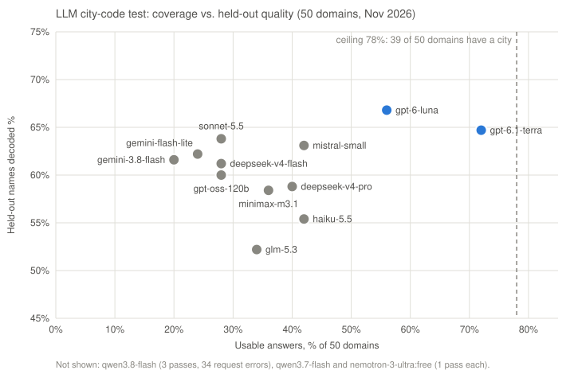
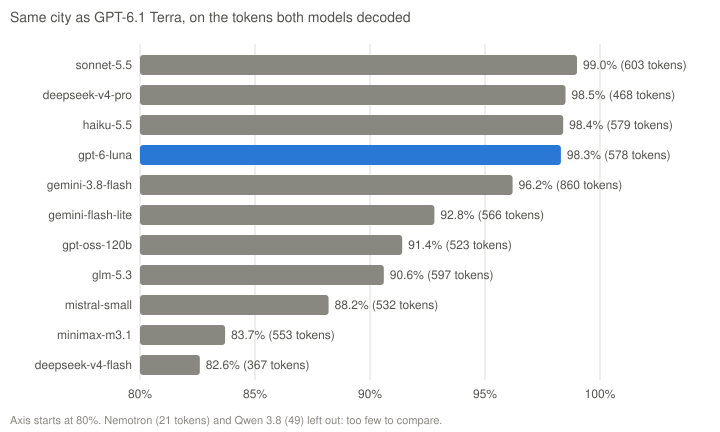

# LLM city-code test

A scratch test, not run by the worker: which LLM best proposes city codes for router-name
domains that `learn-rdns-rules` cannot learn on its own. Each model gets 60 router names of a
domain and answers with a regex (one capture group: the city token) and a token → country/city
map. Nothing is written to the database. Only router hop names are sent, never visitor names.

## Run

From the repo root on the VM (`OPENROUTER_TEST_API_KEY` in `/etc/openipdata/worker.env`):

```bash
( while IFS= read -r l; do case $l in ''|\#*) continue;; esac; export "${l%%=*}=${l#*=}"; done < <(sudo cat /etc/openipdata/worker.env)
  cd tools/llm-codes-test && psql "$PGSQL" -f export.sql && python3 llm_codes_test.py --models openai/gpt-6.1-terra,openai/gpt-6-luna )
```

Answers are saved in `out/<model>.jsonl` (a domain already answered is not asked again), the
log in `out/run.log`. `--report` prints the table again; `--help` lists the options.

The 50 domains: the 40 biggest without a learned rule (test) and the 10 biggest with one
(control: the model's cities are compared with the rule's).

## Results (2026-11-13)

**Choice: openai/gpt-6.1-terra.** It has the most usable answers (36 of the 39 domains that have a
city) and gives the same city as the strongest other models 98-99% of the time. A full run over
today's 358 domains without a rule (5+ router names) costs about $1.60.





| Model | Usable answers (of 50) | Held-out names decoded | Same city as Terra | Control city match | Cost per usable answer |
| --- | --- | --- | --- | --- | --- |
| openai/gpt-6.1-terra | 36 | 64.7% | - | 73% (85 tokens) | 0.61¢ |
| openai/gpt-6-luna | 28 | 66.8% | 98.3% | 94% (51) | 0.19¢ |
| mistralai/mistral-small-2603 | 21 | 63.1% | 88.2% | 80% (35) | 0.87¢ |
| anthropic/claude-haiku-5.5 | 21 | 55.4% | 98.4% | 95% (44) | 0.27¢ |
| deepseek/deepseek-v4-pro | 20 | 58.8% | 98.5% | 100% (29) | 1.66¢ |
| minimax/minimax-m3.1-flash | 18 | 58.4% | 83.7% | 65% (68) | 0.14¢ |
| z-ai/glm-5.3-flash | 17 | 52.2% | 90.6% | 86% (70) | 0.20¢ |
| anthropic/claude-sonnet-5.5 | 14 | 63.8% | 99.0% | 88% (65) | 3.65¢ |
| deepseek/deepseek-v4-flash | 14 | 61.2% | 82.6% | 65% (52) | 0.26¢ |
| openai/gpt-oss-120b | 14 | 60.0% | 91.4% | 79% (86) | 0.09¢ |
| google/gemini-3.1-flash-lite | 12 | 62.2% | 92.8% | 48% (50) | 0.49¢ |
| google/gemini-3.8-flash | 10 | 61.6% | 96.2% | 67% (91) | 1.42¢ |

- **Usable:** the regex works and has one group, at least 2 decoded tokens occur in the names,
  ISO country codes, at least 20% of the names decoded. 11 of the 50 domains have no city in
  their names (all models agree: names like `syn-072-129-061-099.inf.spectrum.com`), so 39 is
  the ceiling. Terra solves every domain Luna solves, plus 8 more.
- **Held-out:** names of the domain the model did not see, averaged over its usable answers.
- **Same city as Terra:** on the tokens both models decoded, across all 50 domains.
- **Control city match** compares with our learned candidate rule, and the rule is often the
  one that is wrong: of Terra's 15 listed mismatches, 12 were our rule (cw.net `lnd` = Lander,
  `fnt` = Flint, `mlb` = Melbourne FL instead of London, Frankfurt, Milan; alter.net `hdn` = Mesa
  instead of Herndon), 2 a district vs. its city, 1 Terra's mistake. So it is no accuracy score.
- Not in the table: qwen/qwen3.8-flash (3 usable, 34 request errors), qwen/qwen3.7-flash and
  nvidia/nemotron-3-ultra-550b-a55b:free (1 usable each, mostly not JSON). DeepSeek V4 Pro had
  10 request errors and took 58 s per request.
- Batch (`:batch` models, `/api/v1/batches`) halves the price but makes the task two-phase
  (submit, collect later); it saves under $1 per full run, so it is not used.

Next: the `propose-codes` task of `learn-rdns-rules`, with Terra.
